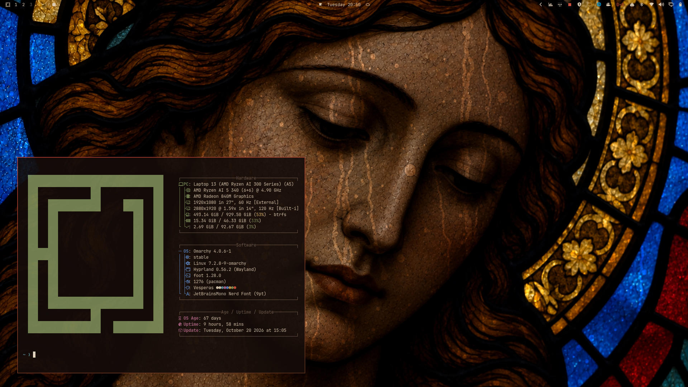

# Vésperas

A dark, melancholic [Omarchy](https://omarchy.org) theme inspired by church stained glass.

Seen from inside a dark church on a rainy evening, an angel in the glass lowers its eyes while rain runs down the other side of the window. The palette comes from the wallpapers: the warm black of the lead, the ivory of the angel's face, ruby, amber and cobalt glass.



## Install

```bash
omarchy theme install https://github.com/This-Is-NPC/omarchy-vesperas-theme
```

## Wallpapers

Three versions of the same window, cycled with the background switcher:

| File | Scene |
| --- | --- |
| `1-face-rain.jpg` | Close-up of the angel's face, rain streaming through the glass |
| `2-dawn-rain.jpg` | The full angel lit by a rising sun after the rain |
| `3-lightning-rain.jpg` | The full angel lit by a lightning flash behind the window |

All three are 3840×2160.

## Palette

| Role | Color |
| --- | --- |
| Background | `#140c09` |
| Foreground | `#dccbb2` |
| Accent | `#c0402f` |
| Red | `#cc4e3a` |
| Yellow | `#c79a42` |
| Orange | `#c96e2c` |
| Green | `#7c8c58` |
| Cyan | `#5a8d96` |
| Blue | `#5582c4` |
| Magenta | `#ad6488` |

Every text color reaches at least 4.5:1 contrast against the background. The accent is used for borders and selection, not text.

## Translucent windows

The theme ships a `hyprland.lua` with translucent, blurred windows so the glass shows through. Omarchy does not load `.lua` files from themes installed with `omarchy theme install`, so after installing you get the colors and wallpapers but opaque windows.

To get the translucent look, add this to `~/.config/hypr/looknfeel.lua`:

```lua
hl.config({
  decoration = {
    blur = {
      enabled = true,
      size = 8,
      passes = 3,
      noise = 0.02,
      brightness = 0.8,
      vibrancy = 0.2,
    },
  },
})

o.window({ tag = "default-opacity" }, { opacity = "0.91 0.84" })
```

The first opacity value applies to the focused window, the second to the others. This setting applies to every theme, not just Vésperas.

## How the wallpapers were made

The stained glass was generated with an image model and the rain was composited locally. See [docs/making-of.md](docs/making-of.md).
